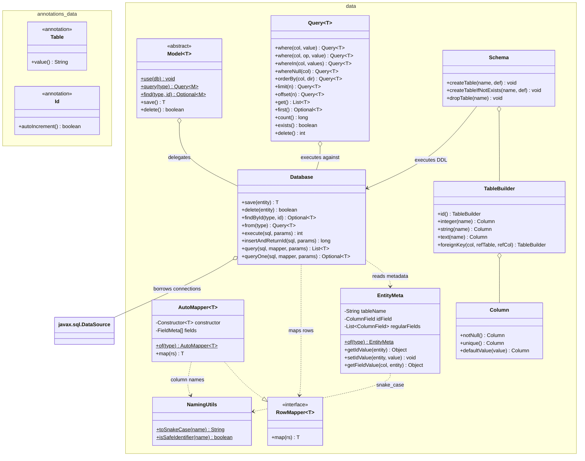

# The Data Layer Explained

This doc explains how the model layer (`com.framework.data`) works — not just what each
class does, but **how the pieces connect**, so you can explain (and debug) it confidently.

## The one-sentence version

> We wrapped raw JDBC in three levels of abstraction: first we removed the boilerplate,
> then we removed the manual row→object mapping, then we removed the SQL itself.

Everything below is just the implementation detail of each step.

## Three layers, bottom to top

```
Level 0 (the problem):  JDBC — verbose, stringly-typed, manual everything
Level 1:  Database       "JDBC without the boilerplate"
Level 2:  AutoMapper     "JDBC that returns objects"
Level 3:  Model + Query + Schema   "no SQL visible at all"
```

Each layer exists to hide the ugliness of the one below it. Every layer needs information
about your model classes — which table, which columns, which field is the id — and that
information comes from **reflection**, collected once and cached. That is the hidden
fourth player:

```
EntityMeta (+ NamingUtils) = the "directory" every layer consults
```

## The players, by job

| Class | Job in one line |
|---|---|
| `NamingUtils` | translates names: Java `createdAt` ↔ SQL `created_at` |
| `EntityMeta` | reads a model class once, remembers: table name, id field, all columns |
| `AutoMapper` | DB row → Java object |
| `RowMapper` | the contract "give me a row, I give you an object" (functional interface) |
| `Database` | actually talks to JDBC: run SQL, get rows; also the ORM operations |
| `Query` | assembles SQL from chained conditions |
| `Model` | what user code touches; delegates to everything else |
| `Schema` / `TableBuilder` / `Column` | builds `CREATE TABLE` statements in Java |
| `@Table` / `@Id` | optional overrides for the naming conventions |

## Trace: saving a note, end to end

One concrete trace beats ten abstract diagrams. Walk through what happens when the
controller calls `note.save()` on a new note:

1. **Controller says `note.save()`.**
   The controller knows nothing about SQL, tables, or the database. `Model.save()` does
   one thing: `db().save(this)` — "hand me to the default Database."

2. **`Database.save(entity)` asks the directory.**
   It calls `EntityMeta.of(Note.class)`. The *first time ever*, that constructor runs:
   it reads `@Table("notes")` → table name, finds the `@Id` field, snake-cases every
   field name via `NamingUtils` → list of columns. Then it caches everything in a
   `ConcurrentHashMap`. Every later call is a dictionary lookup.

3. **One decision: insert or update?**
   `save()` reads the id value: `null` or `0` → new row → INSERT; otherwise → UPDATE.
   No SQL yet — just a decision.

4. **SQL is generated from the metadata.**
   `insert()` loops over the cached column list and builds
   `INSERT INTO notes (user_id, title, body, created_at) VALUES (?, ?, ?, ?)` —
   values pulled out of the object by reflection (`getFieldValue`). Values go in as
   `?` placeholders (injection-safe); the column list comes from the cache.

5. **JDBC executes it.**
   `PreparedStatement`, bind params, `executeUpdate()`. Because the id is
   auto-increment, the driver is asked for the generated key (`getGeneratedKeys()`)
   and the answer is written back into the Java object via `setIdValue(...)`.
   This is why `note.save()` leaves the object *knowing its own id*.

6. **Reading it back is the same story in reverse.**
   Controller: `Model.query(Note.class).where("userId", 1).get()`.
   - `Query` just **accumulates**: `where()` appends `"user_id = ?"` to a clauses list
     and `1` to a params list. No database yet.
   - `get()` **compiles** the lists into one SQL string and hands it to
     `Database.query(sql, Note.class, params)`.
   - `Database` runs JDBC and calls `AutoMapper.map(row)` for each row.
   - `AutoMapper` reads the result set's own metadata (which columns came back),
     matches them against its cached field list, does `constructor.newInstance()`
     for a blank `Note`, then `field.set(instance, value)` per column.

**Symmetry — that's the design.**
Insert: object → (metadata) → SQL → row. Read: row → (same metadata) → object.
`EntityMeta` and `NamingUtils` serve both directions, which is why there is no
duplication between write and read paths.

## Answers to the questions people actually ask

**"Why a cache?"**
Reflection is slow. `EntityMeta.of()` and `AutoMapper.of()` pay the class-scan cost
once per class; saving 1000 notes reuses one metadata object.

**"Why does `Model` exist if `Database.save()` works?"**
Two entry points for two styles: `Model` is the ActiveRecord style (`note.save()`),
`Database` is the repository style (`db.save(note)`). Both hit the same code; `Model`
just needs `Model.use(db)` called once at startup so instances know which database to use.

**"How is it injection-safe?"**
Two weapons for two different problems:
- *Values* can never be concatenated into SQL → they are `?` placeholders bound by
  `PreparedStatement`.
- *Identifiers* (table/column names) can't be placeholders in SQL → they are
  snake-cased and validated against `^[a-zA-Z_][a-zA-Z0-9_]*$`
  (`NamingUtils.isSafeIdentifier`), and operators are whitelisted
  (`=, !=, <, >, LIKE, ...`).

**"What if my model and my schema disagree?"**
Nothing checks them against each other — that is the one seam. Both `Schema` and the
ORM snake-case names, so they agree *if you keep both consistent*. Rule: the class name
(in snake_case) must match the table you create, or add `@Table("...")` to the model.
The demo does this: class `Note` → `@Table("notes")`.

**"Where do connections live?"**
`Database` borrows a connection from the `DataSource` per call and always closes it
(try-with-resources). It holds no connection state, which makes it safe under the
server's request threads.

**"What about errors?"**
Every `SQLException` is wrapped into an unchecked `DatabaseException` carrying the
offending SQL, so callers don't need `try/catch` everywhere but failures aren't silent.

## The 30-second elevator version

> Each model class extends `Model`, which at startup gets scanned by reflection into a
> cached metadata object — table name, id, columns. Saving builds an INSERT from that
> metadata and executes it through a thin JDBC wrapper, reading the generated id back
> into the object. Queries are a fluent builder that compiles chained conditions into
> parameterized SQL, and results are hydrated back into objects automatically. So
> controllers just say `note.save()` and `query().where(...).get()` — all SQL lives
> inside the framework.

## Class map (mermaid)


